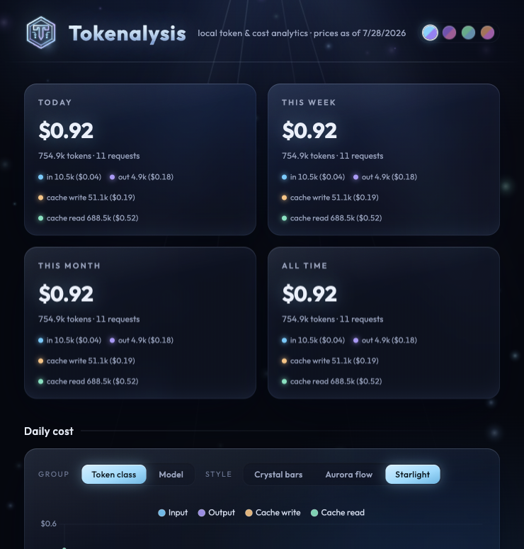
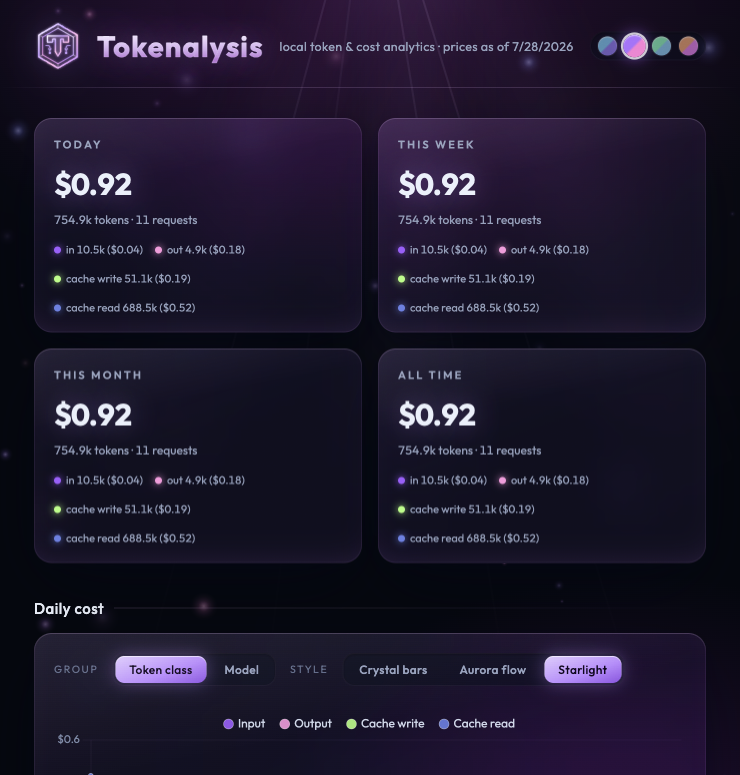
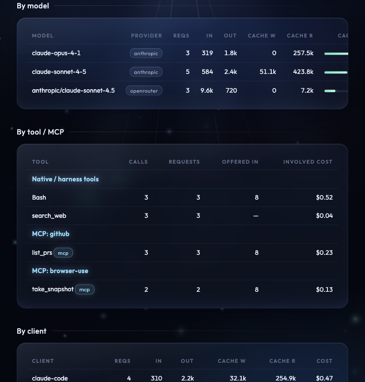

# Tokenalysis

[](https://github.com/Philificent/tokenalysis/actions/workflows/docker-publish.yml)
[](https://github.com/Philificent/tokenalysis/tags)
[](https://github.com/Philificent/tokenalysis/pkgs/container/tokenalysis)
[](LICENSE)

A local proxy for LLM APIs that records what providers don't show you: per-request **input / output / cache-write / cache-read** token counts, which **tools and MCP servers** were involved, which **clients and models** burned the tokens, and the **dollar cost** of each class — with a built-in dashboard.

Single Node process. SQLite storage. No external services. Your API keys pass through untouched and are never stored.




## Quick start

### Docker (recommended)

```sh
docker compose up -d
```

That's it — the container builds, stores its history in the `tokenalysis-data` volume (survives rebuilds and upgrades), and publishes the port to **your machine's loopback only** (`127.0.0.1:4141`), the same posture as running bare. If you want other machines on your network to use the proxy, change the `ports:` mapping in [compose.yaml](compose.yaml) to `"4141:4141"` — deliberately, since anyone who can reach the port can see your usage data and relay traffic through the proxy.

Prefer a prebuilt image over a local build? Every `v*.*.*` git tag publishes a multi-arch image (`linux/amd64` + `linux/arm64`) to GHCR, so you can swap the `build: .` line in [compose.yaml](compose.yaml) for:

```yaml
    image: ghcr.io/philificent/tokenalysis:latest
```

### Bare Node

```sh
npm install
npm run build
npm start
```

Then open the dashboard at **http://127.0.0.1:4141/** and point your clients at the proxy:

| Client | One-liner |
|---|---|
| Claude Code | `ANTHROPIC_BASE_URL=http://127.0.0.1:4141/anthropic claude` |
| Anthropic SDK (TS/Python) | set `baseURL` / `base_url` to `http://127.0.0.1:4141/anthropic` |
| OpenRouter (OpenAI SDK) | set `baseURL` to `http://127.0.0.1:4141/openrouter/api/v1` |
| curl | `curl http://127.0.0.1:4141/anthropic/v1/messages ...` |

Dev mode (auto-reload): `npm run dev`

## What gets recorded

For every completion request (`/v1/messages` on Anthropic, `/api/v1/chat/completions` on OpenRouter):

- **Tokens by class**: input, output, cache creation (write), cache read — parsed from JSON responses and from SSE streams (`message_start` / `message_delta` events on Anthropic; final usage chunk on OpenRouter).
- **Cost by class**: computed at insert time against the latest pricing snapshot and stored immutably. When OpenRouter reports an actual `usage.cost`, that wins for the total.
- **Tool calls**: `tool_use` blocks from responses. Names following the `mcp__<server>__<tool>` convention (Claude Code) are attributed to their MCP server. The request's offered `tools` list is stored too, so you can compare offered vs. actually called.
- **Client**: the `x-tokenalysis-client` header if present, otherwise `User-Agent`.
- Status, latency, streaming flag, and a `parse_error` marker when usage couldn't be extracted (the proxied response is never affected by recording failures).

All other endpoints (model lists, token counting, etc.) are proxied transparently without recording.

## Pricing

A weekly job (checked hourly, refreshed when the newest snapshot is older than 7 days) pulls two machine-readable sources — no HTML scraping:

- `https://openrouter.ai/api/v1/models` — per-token prices for every OpenRouter model, including cache read/write.
- LiteLLM's `model_prices_and_context_window.json` — direct-API rates, including Anthropic's `cache_creation_input_token_cost` / `cache_read_input_token_cost`.

Both are normalized to USD per million tokens and stored as dated snapshots. If a fetch fails, the previous snapshot stays live and a warning appears on the dashboard. Models with no known price are recorded with `NULL` cost and flagged **unpriced** in the UI.

## Dashboard

- Headline cards: cost + tokens for today / this week / this month / all time, each split into the four token classes.
- Daily cost chart, stacked by token class or grouped by model.
- Tables: by model (with cache-hit ratio), by tool / MCP server (call counts + involved cost), by client, and the last 100 requests with per-request drill-down.

The server binds to `127.0.0.1` unless you override `HOST`.

### Screenshots

The whole interface is a themeable duotone (Glacier / Nebula / Verdant / Ember), and the tables break usage down by model (with cache-hit ratio), tool / MCP server, and client:

| Duotone theming | Model / tool / client breakdown |
|---|---|
|  |  |

## Configuration

| Env var | Default | Meaning |
|---|---|---|
| `PORT` | `4141` | Listen port |
| `HOST` | `127.0.0.1` | Bind address. The Docker image sets `0.0.0.0` (the container port is still only published to the host's loopback by default) |
| `DB_PATH` | `./tokenalysis.db` | SQLite database file (`/data/tokenalysis.db` in Docker) |
| `INJECT_OPENROUTER_USAGE` | `true` | Add `usage: {include: true}` to OpenRouter requests so streamed responses report usage/cost. Set to `false` for byte-exact request passthrough (streamed usage will then be null unless the client asks for it). |
| `ANTHROPIC_UPSTREAM` | `https://api.anthropic.com` | Override upstream (tests) |
| `OPENROUTER_UPSTREAM` | `https://openrouter.ai` | Override upstream (tests) |
| `PRICING_REFRESH_ENABLED` | `true` | Disable the weekly pricing scheduler |

## Tests

```sh
npm test
```

Covers SSE reassembly across chunk boundaries, usage extraction for streamed and JSON bodies on both providers, MCP name parsing, per-class cost math, pricing-source normalization, and an end-to-end integration test against a mock upstream asserting byte-identical passthrough and correct database rows.

## Notes

- Cost is attributed at request granularity: a request that called tool X counts fully toward X's "involved cost". Providers don't expose per-tool token splits.
- v1 records Anthropic and OpenRouter. Other providers pass through unrecorded if you point them at an existing mount.

## License

[MIT](LICENSE) © Philificent
